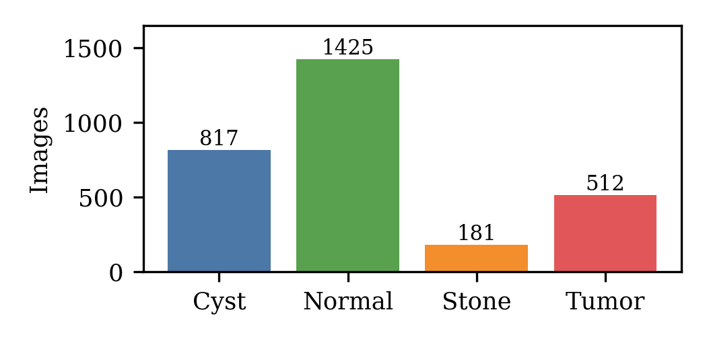
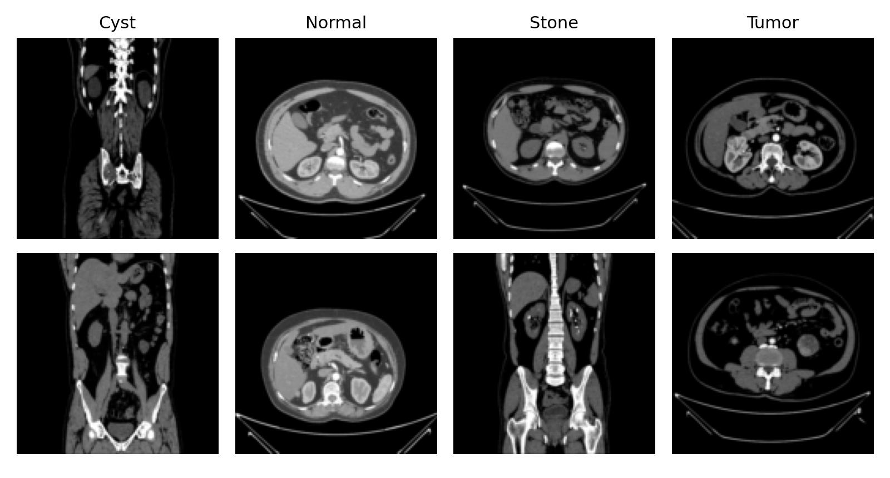
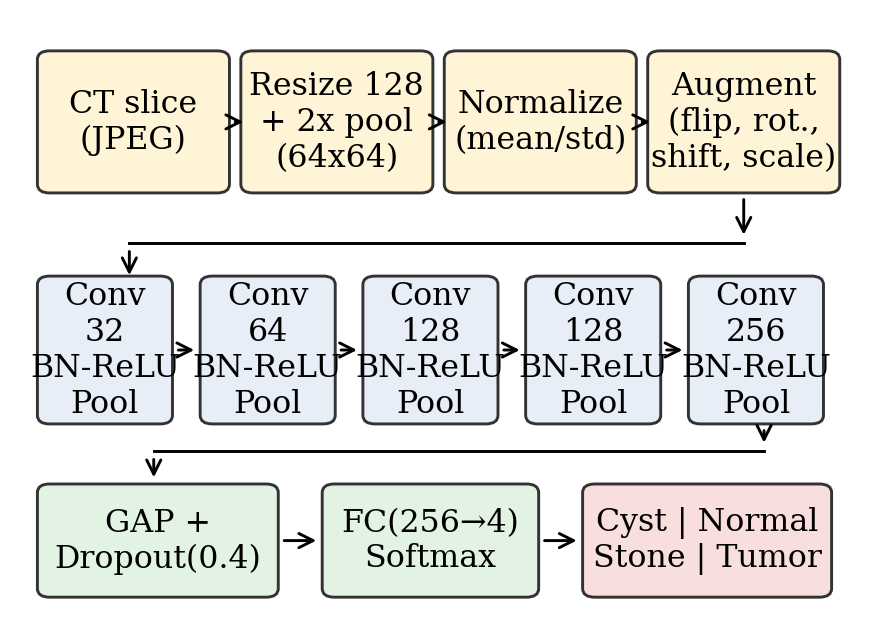
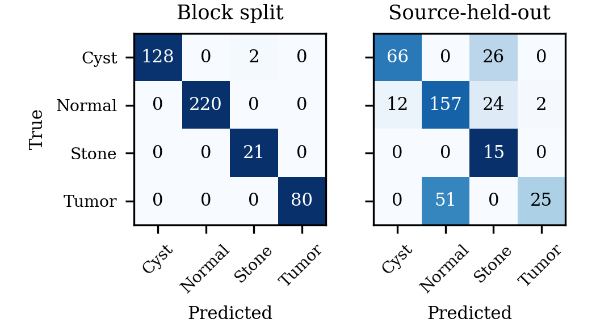
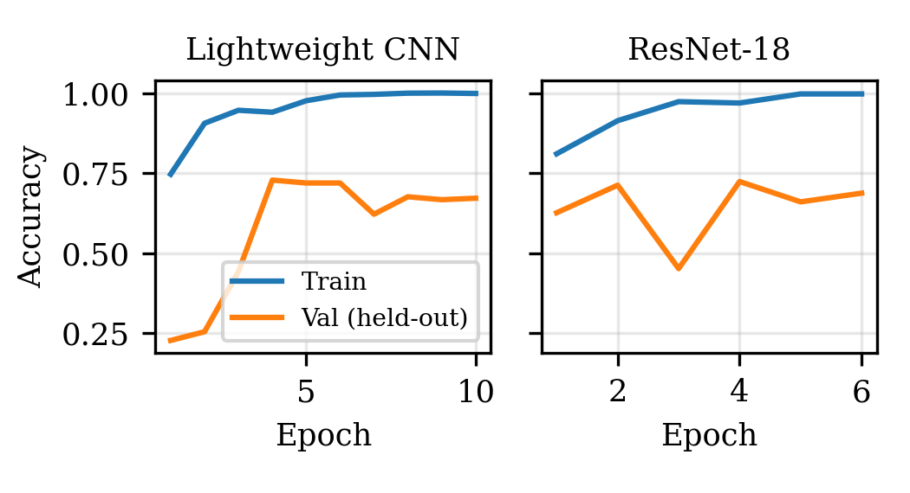

# Kidney CT Classification: Cyst, Normal, Stone and Tumor

**A source-aware deep learning study on CT kidney images**

| | |
|---|---|
| **Author** | Aaryaman Singh |
| **Registration No.** | 2430010383 |
| **Programme** | B.Tech, Computer Science and Engineering (Data Science) |
| **Institution** | Manipal University Jaipur (MUJ) |
| **Contact** | aaryamansingh366@gmail.com |
| **Paper** | [`Kidney_CT_IEEE_Research_Paper.pdf`](Kidney_CT_IEEE_Research_Paper.pdf) (IEEE format) |

---

## 1. Overview

This project classifies kidney CT slices into four categories (**Cyst, Normal, Stone, Tumor**) using three approaches: a classical HOG + linear SVM baseline, a lightweight 5-block CNN, and ResNet-18 trained from scratch.

While checking the dataset I found that the images are strongly clustered by scan source, so a conventional train/test split gives misleadingly high scores (up to 100%). The project therefore evaluates every model under **two protocols**: a *block split* and a stricter *source-held-out split*. The gap between the two is the main finding.

### Highlights
- Four-class CT classification with three models and two evaluation protocols.
- Dataset diagnostics showing class-specific image sizes and a 100% pixel 1-NN score on the block split.
- Resumable training script (checkpoint every epoch), runnable on a CPU.
- IEEE-format research paper, all metrics, test predictions and figures included.

## 2. Dataset

2,935 JPEG CT images in four class folders.

| Class | Images | Share |
|---|---|---|
| Normal | 1,425 | 48.6% |
| Cyst | 817 | 27.8% |
| Tumor | 512 | 17.4% |
| Stone | 181 | 6.2% |




The dataset is **not included** in this repository (about 420 MB). It appears to be the public CT kidney dataset of Islam et al. (2022), cited below; download it from the original source and unzip it into `data/` so that the layout is:

```
data/CT-KIDNEY-DATASET-Normal-Cyst-Tumor-Stone/
    CT-KIDNEY-DATASET-Normal-Cyst-Tumor-Stone/
        Cyst/*.jpg   Normal/*.jpg   Stone/*.jpg   Tumor/*.jpg
```
Use the `DATA_DIR` environment variable if the data is stored elsewhere (default: `data`).

### Dataset diagnostics (`diag.py`)
- 28 distinct original image sizes (for example 512×512, 867×701, 1221×988); **27 of 28 occur in exactly one class**.
- Predicting the majority class per image size scores 69.2% on the block-split test set.
- A pixel-space 1-nearest-neighbour classifier scores **100%** on the block split.
- No patient identifiers are provided, so true patient-level splitting is impossible.

## 3. Evaluation protocols

| Split | How it is built | Train / Val / Test |
|---|---|---|
| **Block** (seed 42) | Within each class, images are ordered by file index, grouped in contiguous blocks of 10, and whole blocks go to one subset (about 70/15/15). | 2,044 / 440 / 451 |
| **Source-held-out** (seed 344) | All images sharing a class and original image size form one source group; whole groups go to one subset. | 2,116 / 441 / 378 |

The seed for the source-held-out split was chosen only so that all four classes appear in validation and test with adequate counts (test: 92 Cyst, 195 Normal, 15 Stone, 76 Tumor). No model performance was used to choose it. Splitting logic lives in `common.py`.

## 4. Methodology

**Preprocessing.** RGB conversion, bilinear resize to 128×128, 2×2 average pooling to 64×64 for training, standardization with training-set mean/std. Training augmentation: horizontal flip, rotation ±10°, scale ±10%, translation ±6%, brightness/contrast jitter ±10%. No augmentation at validation/test.

**Models**
- *HOG + SVM:* grayscale 128×128, HOG (9 orientations, 16×16 cells, 2×2 blocks, 1,764 features), standardized, class-balanced `LinearSVC`; `C` chosen on validation data.
- *Lightweight CNN* (537,636 parameters): five blocks of Conv3×3 → BatchNorm → ReLU → MaxPool (32, 64, 128, 128, 256 channels), global average pooling, dropout 0.4, linear layer.
- *ResNet-18* (11,178,564 parameters): torchvision architecture with a 4-way head, random initialization (no pretrained weights).



**Training.** Class-weighted cross-entropy (weights ∝ √(N / (4·n_c))) with label smoothing 0.05, AdamW (weight decay 1e-4; peak LR 2e-3 for the CNN, 1e-3 for ResNet-18), one-cycle schedule, batch size 32, CNN 10 epochs and ResNet-18 6 epochs. The checkpoint with the best validation macro-F1 is evaluated once on the test set.

## 5. Results

Metrics are macro-averaged over the four classes (percent), computed on the test set.

### 5.1 Block split (test n = 451)
| Model | Accuracy | Precision | Recall | F1 | AUC |
|---|---|---|---|---|---|
| HOG + linear SVM | 100.0 | 100.0 | 100.0 | 100.0 | – |
| Lightweight CNN | 96.9 | 90.5 | 97.3 | 92.9 | 0.999 |
| ResNet-18 (scratch) | 99.6 | 97.8 | 99.6 | 98.7 | 1.000 |

### 5.2 Source-held-out split (test n = 378)
| Model | Accuracy | Precision | Recall | F1 | AUC |
|---|---|---|---|---|---|
| HOG + linear SVM | 19.6 | 24.4 | 22.6 | 18.0 | – |
| Lightweight CNN | 57.1 | 37.3 | 54.7 | 41.1 | 0.695 |
| ResNet-18 (scratch) | 69.6 | 68.9 | 71.3 | 60.4 | 0.763 |

### 5.3 Per-class recall (%), source-held-out split
| Model | Cyst | Normal | Stone | Tumor |
|---|---|---|---|---|
| HOG + linear SVM | 38.0 | 16.4 | 33.3 | 2.6 |
| Lightweight CNN | 100.0 | 59.0 | 60.0 | 0.0 |
| ResNet-18 (scratch) | 71.7 | 80.5 | 100.0 | 32.9 |

### 5.4 Cost
| Model | Parameters | Training time (1 CPU core) | Inference (CPU, ms/image) |
|---|---|---|---|
| Lightweight CNN | 537,636 | about 225 s | 2.7 |
| ResNet-18 | 11,178,564 | about 281 s | 4.2 |




### 5.5 Discussion
- Under the block split every model scores very high, even HOG + SVM (100%), because test images come from the same scans as training images.
- Under the source-held-out split accuracy falls to 19.6% (HOG + SVM), 57.1% (CNN) and 69.6% (ResNet-18). Training accuracy stays near 100% while validation accuracy plateaus, which indicates overfitting to source-specific cues.
- Tumor is the hardest class on the strict split (0.0% recall for the CNN, 32.9% for ResNet-18).
- The held-out split is still only a proxy for patient-level separation.

## 6. Limitations
1. Each configuration was run once (single seed); no confidence intervals.
2. Low input resolution (64×64) and short training because of a one-CPU-core budget.
3. ResNet-18 was trained from scratch, not fine-tuned from pretrained weights.
4. Only 15 Stone images in the source-held-out test set, so Stone metrics are unreliable.
5. Image size is used as a proxy for scan source, not as a true patient identifier.
6. 2D slices only; this is a research study, not a clinically validated tool.

## 7. Future work
Fine-tune pretrained networks at higher resolution, obtain patient identifiers for patient-level splits, repeat over multiple seeds, add CT windowing and Grad-CAM explainability, and validate on an external dataset.

## 8. Reproducing the results

**Environment used:** Python 3.12.3, PyTorch 2.15.0, scikit-learn 1.8.0, scikit-image 0.26.0; single CPU core, 3 GB RAM, no GPU.

```bash
pip install -r requirements.txt
# place the dataset in ./data (see Section 2), then either:
bash run_all.sh
# or step by step:
python prep.py                          # resize images -> ct128.npz, sample figure
python diag.py                          # dataset shortcut diagnostics
python baseline.py block && python baseline.py group
python train.py cnn block 10      && python train.py cnn group 10
python train.py resnet18 block 6  && python train.py resnet18 group 6
python figs.py                          # figures from the result files
```
`train.py` saves a checkpoint after every epoch (`ck_<model>_<split>.pt`) and resumes automatically if interrupted. Results will not match the paper to the last digit on different hardware or library versions.

## 9. Repository structure
All files sit in one flat folder (no subfolders), so the project can be uploaded through GitHub's web uploader without losing anything. Create a local `data/` folder for the dataset (it is git-ignored).
```
README.md, LICENSE, requirements.txt, run_all.sh, .gitignore
prep.py                  dataset to 128x128 array + sample figure
common.py                data loading, block and source-held-out splits
diag.py                  dataset shortcut / leakage diagnostics
baseline.py              HOG + linear SVM
train.py                 lightweight CNN and ResNet-18 (resumable)
figs.py                  figure generation
summary.csv, per_class_recall.csv     all metrics
res_<model>_<split>.json              per-run metrics, confusion matrices, history
probs_<model>_<split>.npy             test-set softmax outputs
w_cnn_block.pt, w_cnn_group.pt        CNN weights (ResNet weights omitted for size)
fig_arch.png, fig_cm.png, fig_curves.png, fig_dist.png, fig_samples.png
Kidney_CT_IEEE_Research_Paper.pdf / .docx, build_paper.js     the IEEE paper
```

## 10. Reference for the dataset
M. N. Islam, M. Hasan, M. K. Hossain, M. G. R. Alam, M. Z. Uddin, and A. Soylu, "Vision transformer and explainable transfer learning models for auto detection of kidney cyst, stone and tumor from CT-radiography," *Scientific Reports*, vol. 12, Art. no. 11440, 2022.

## 11. License and author
Code released under the MIT License (see `LICENSE`). The dataset has its own terms from its original authors.

© 2026 Aaryaman Singh (Reg. No. 2430010383), Manipal University Jaipur.
